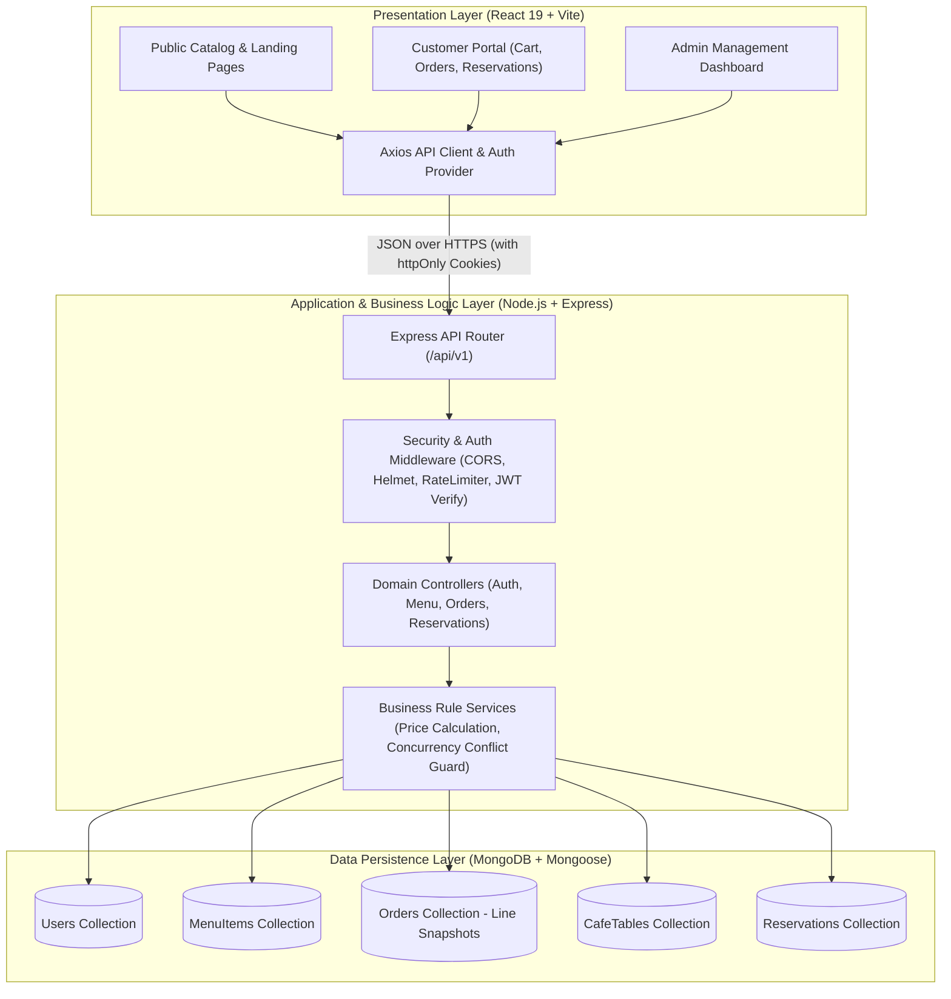
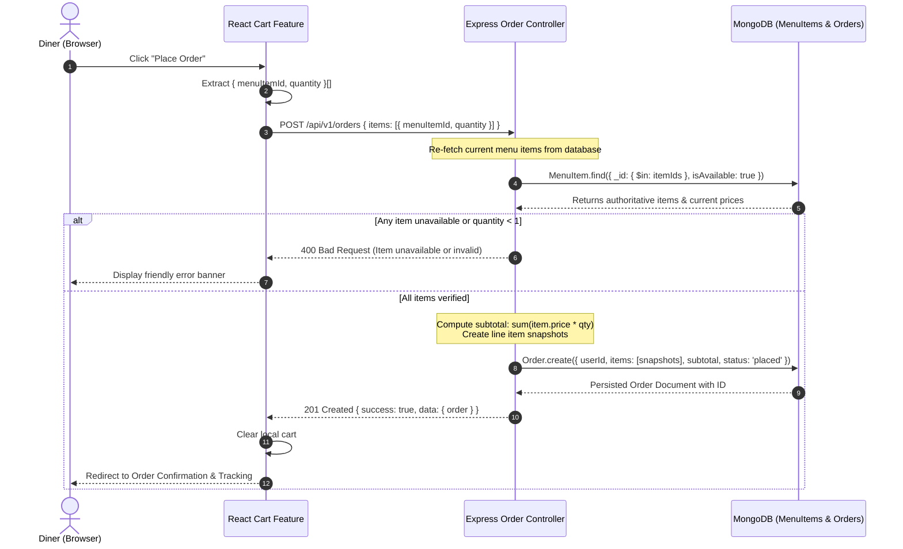
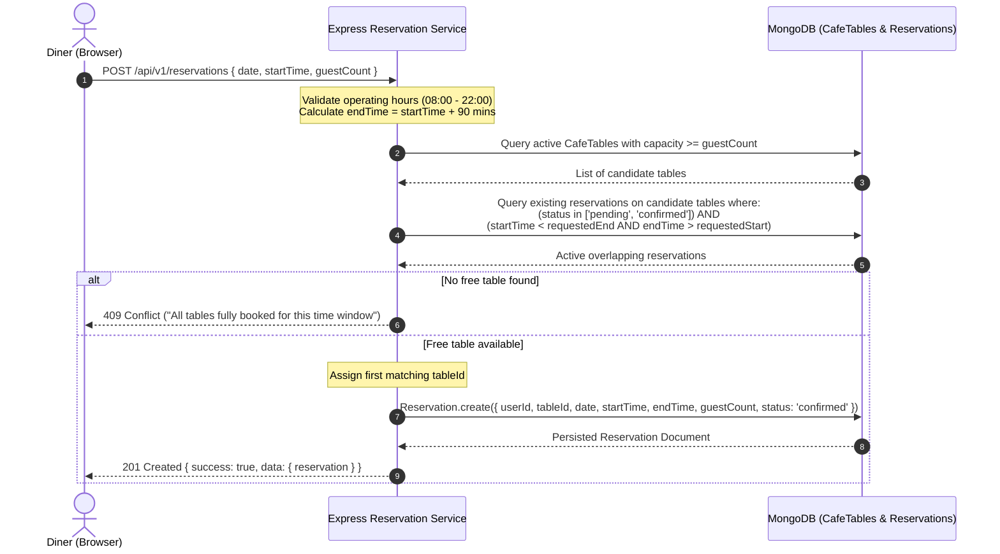
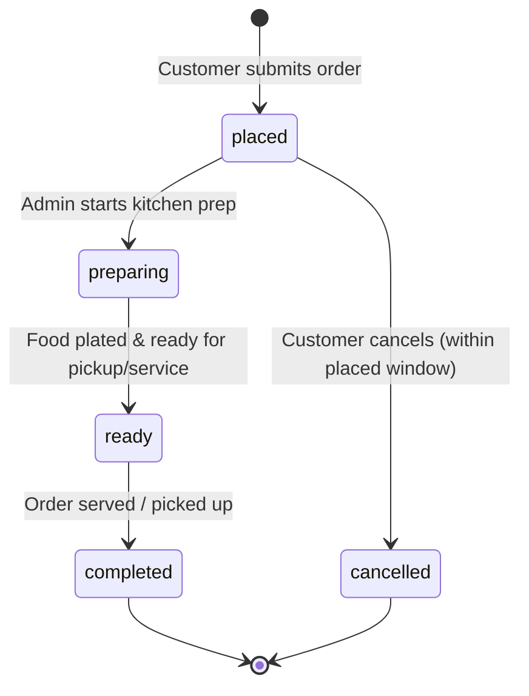
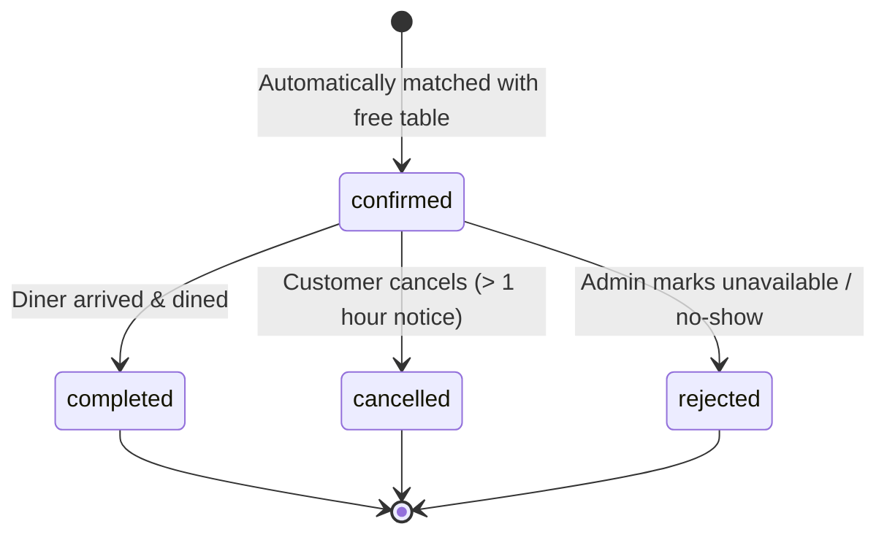

# Verdora — System Architecture & Design Specification

**Document Version:** 1.0  
**Phase:** Phase 1 — Requirements, UX and Architecture  
**Technology Stack:** React 19 (Vite), Node.js / Express.js, MongoDB / Mongoose  
**Author / Contributor:** Dasitha Nayanapriya 

---

## 1. High-Level Architecture Overview

Verdora follows a clean, decoupled **Client-Server 3-Tier Architecture**:



---

## 2. Sequence Diagrams & Data Flows

### 2.1 Order Placement & Server-Authoritative Calculation Flow

The client calculates subtotals strictly for presentation. The server independently recalculates all line items against authoritative database records and generates immutable price snapshots.



---

### 2.2 Table Reservation & Conflict Prevention Flow

To prevent double-booking, the reservation service checks for overlapping time intervals ($[Start, End)$) on active tables before saving.



---

## 3. Lifecycle State Transition Diagrams

### 3.1 Order Lifecycle



### 3.2 Reservation Lifecycle



---

## 4. Route Inventory & Navigation Map

```text
/ (Public Landing Page)
├── /menu                         # Public Menu catalog (Search, Filters, Sort)
├── /menu/:id                     # Single item nutritional breakdown
├── /login                        # Authentication
├── /register                     # New customer registration
│
├── /cart                         # Customer Cart Review
├── /checkout                     # Order confirmation & notes
├── /orders/my                    # Customer Order History & status tracking
├── /orders/:id                   # Order detail receipt
├── /reservations                 # Table booking form
├── /reservations/my              # Customer upcoming reservations & cancel action
│
└── /admin                        # Protected Admin Operations
    ├── /admin/dashboard          # Key metrics (Active orders, Today's covers)
    ├── /admin/menu               # Menu CRUD management table
    ├── /admin/orders             # Kitchen display system & status controls
    └── /admin/reservations       # Daily reservation roster & table assignments
```

---

## 5. Standardized API Response & Error Contracts

All responses follow a consistent schema:

### Success Contract (`200 OK`, `201 Created`):
```json
{
  "success": true,
  "data": {
    "item": {}
  }
}
```

### Standardized Error Contract (`400`, `401`, `403`, `404`, `409`, `500`):
```json
{
  "success": false,
  "error": {
    "code": "CONFLICT",
    "message": "The selected dining slot is no longer available. Please select another time.",
    "details": []
  }
}
```

### Standard Error Codes:
* `VALIDATION_ERROR` (400) — Malformed input, invalid emails, negative prices.
* `UNAUTHORIZED` (401) — Missing, expired, or malformed JWT token.
* `FORBIDDEN` (403) — Customer attempting to perform administrative mutations or access another user's records.
* `NOT_FOUND` (404) — Requested resource does not exist.
* `CONFLICT` (409) — Duplicate email registration or reservation table collision.
* `INTERNAL_SERVER_ERROR` (500) — Unhandled backend exception (sanitized to prevent secret leaks).

---

## 6. UI/UX Design System & State Guidelines

### 6.1 Color Tokens & Theming
* **Primary (Botanical Wellness):** `#22c55e` (Emerald Green), `#16a34a` (Deep Leaf).
* **Warm Accent (Grains & Sun):** `#eab308` (Golden Harvest), `#e06d53` (Warm Terracotta).
* **Background Surfaces:** `#0b130e` (Deep Obsidian Green), `#121f17` (Surface Layer), `#16261d` (Glass Cards).
* **Typography:** `Outfit` (Headings, Branding), `Plus Jakarta Sans` (Body, Controls, Tables).

### 6.2 The Five Core UI States
1. **Loading State:** Semi-transparent skeleton loaders and glowing spinner badges (preventing double clicks with `disabled` states).
2. **Empty State:** Illustrated empty banners with clear calls-to-action (e.g., "Your cart is empty — Explore fresh bowls").
3. **Validation State:** Inline form feedback with red indicator rings and accessible descriptive text below input controls.
4. **Success State:** Non-intrusive floating toasts and animated confirmation checkmarks.
5. **Confirmation Modals:** Double-confirmation dialogue for destructive actions (e.g., deactivating a menu item or cancelling a table reservation).
