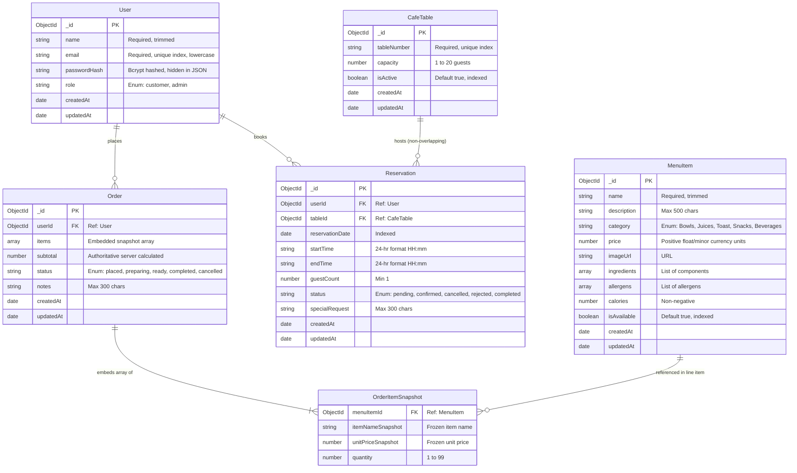

# Verdora — Database Design & Schema Dictionary

**Document Version:** 1.0  
**Phase:** Phase 2 — MongoDB Connection & Data Models  
**Database Engine:** MongoDB (via Mongoose ODM)  
**Author / Contributor:** dasithaDev  

---

## 1. Entity Relationship Diagram (ERD)



---

## 2. Collections & Data Dictionary

### 2.1 `users` Collection

Stores customer accounts and cafe administrator credentials.

| Field Name | BSON Type | Constraints & Validation | Description |
| :--- | :--- | :--- | :--- |
| `_id` | ObjectId | Auto-generated Primary Key | Unique user identifier |
| `name` | String | Required, trim, 2–50 characters | Full legal or display name |
| `email` | String | Required, trim, lowercase, unique index, email regex | Login username and communication address |
| `passwordHash`| String | Required, min length 60 | Bcrypt hashed password (salt factor 10). Excluded from JSON serialization |
| `role` | String | Enum: `['customer', 'admin']`, default: `'customer'` | Role-based authorization tier |
| `createdAt` | Date | Auto-populated by Mongoose | Timestamp of registration |
| `updatedAt` | Date | Auto-populated by Mongoose | Timestamp of last modification |

---

### 2.2 `menuitems` Collection

Stores organic food items, nutritional metrics, and availability flags.

| Field Name | BSON Type | Constraints & Validation | Description |
| :--- | :--- | :--- | :--- |
| `_id` | ObjectId | Auto-generated Primary Key | Unique menu item ID |
| `name` | String | Required, trim, max 100 characters | Name of the dish or drink |
| `description` | String | Trim, max 500 characters | Detailed ingredients and flavor profile |
| `category` | String | Enum: `['Bowls', 'Juices', 'Toast', 'Snacks', 'Beverages']` | Classification for UI filtering |
| `price` | Number | Required, minimum `0.01` | Price in local currency units (positive number) |
| `imageUrl` | String | Trim, URL | Image representation of item |
| `ingredients` | Array of String| Default `[]` | List of primary ingredients |
| `allergens` | Array of String| Default `[]` | Allergen warnings (e.g., Nuts, Gluten, Soy) |
| `calories` | Number | Optional, min `0` | Estimated calories per portion |
| `isAvailable` | Boolean | Default `true`, indexed | Soft-delete flag; deactivates item without breaking order history |
| `createdAt` | Date | Auto-populated | Record creation timestamp |
| `updatedAt` | Date | Auto-populated | Record update timestamp |

**Indexes:**
* Compound Index: `{ category: 1, isAvailable: 1 }` for rapid catalog queries.

---

### 2.3 `cafetables` Collection

Physical dining tables inside the cafe available for reservations.

| Field Name | BSON Type | Constraints & Validation | Description |
| :--- | :--- | :--- | :--- |
| `_id` | ObjectId | Auto-generated Primary Key | Unique table ID |
| `tableNumber` | String | Required, trim, unique index | Table identifier (e.g., `T-01`, `T-02`) |
| `capacity` | Number | Required, integer, min `1`, max `20` | Maximum seated guest limit |
| `isActive` | Boolean | Default `true`, indexed | Availability of table for booking |

---

### 2.4 `reservations` Collection

Tracks customer dining reservations and table occupancy over time.

| Field Name | BSON Type | Constraints & Validation | Description |
| :--- | :--- | :--- | :--- |
| `_id` | ObjectId | Auto-generated Primary Key | Unique reservation ID |
| `userId` | ObjectId | Required, ref `User`, indexed | Customer who placed the booking |
| `tableId` | ObjectId | Required, ref `CafeTable`, indexed | Allocated cafe table |
| `reservationDate`| Date | Required, indexed | Normalized calendar date of booking |
| `startTime` | String | Required, regex `^([01]\d\|2[0-3]):([0-5]\d)$` | 24-hour dining start time (e.g. `12:00`) |
| `endTime` | String | Required, regex `^([01]\d\|2[0-3]):([0-5]\d)$` | Calculated 24-hour end time (e.g. `13:30`) |
| `guestCount` | Number | Required, min `1`, max `20` | Number of diners |
| `status` | String | Enum: `['pending', 'confirmed', 'cancelled', 'rejected', 'completed']` | Reservation lifecycle status |
| `specialRequest`| String | Optional, max 300 characters | Dietary or seating notes |

**Indexes:**
* Compound Index: `{ tableId: 1, reservationDate: 1, status: 1 }` for concurrency conflict queries.

---

### 2.5 `orders` Collection & Snapshot Architecture

Stores placed customer orders. Line items are frozen snapshots so that subsequent menu price alterations or dish renamings do not distort past financial records.

| Field Name | BSON Type | Constraints & Validation | Description |
| :--- | :--- | :--- | :--- |
| `_id` | ObjectId | Auto-generated Primary Key | Unique order ID |
| `userId` | ObjectId | Required, ref `User`, indexed | Customer placing order |
| `items` | Array of Objects | Required, non-empty | Embedded line item snapshots |
| `items.menuItemId` | ObjectId | Required, ref `MenuItem` | Historical reference to item |
| `items.itemNameSnapshot` | String | Required, trim | Name at the moment of order placement |
| `items.unitPriceSnapshot`| Number | Required, min `0` | Authoritative unit price at moment of placement |
| `items.quantity` | Number | Required, min `1`, max `99` | Number of portions ordered |
| `subtotal` | Number | Required, min `0` | Server-calculated total |
| `status` | String | Enum: `['placed', 'preparing', 'ready', 'completed', 'cancelled']` | Kitchen order lifecycle status |
| `notes` | String | Optional, max 300 characters | Kitchen preparation notes |

**Indexes:**
* Compound Index: `{ userId: 1, createdAt: -1 }` for ordering customer history.

---

## 3. Database Seed Procedure

The seed script is located at `server/src/seeds/seed.js` and run via `npm run seed`:
1. Connects to `MONGODB_URI` from `.env`.
2. Verifies if admin and demo accounts exist; creates them with bcrypt-hashed passwords if absent.
3. Populates 8 dining tables (`T-01` to `T-08`) with 2, 4, 6, and 8-seat capacities.
4. Populates 8 organic healthy menu items across Bowls, Juices, Toast, Beverages, and Snacks.
5. **Idempotency Guarantee:** Running the seed multiple times will not duplicate existing documents or crash.

---

## 4. Example JSON Documents (Fictional Data)

### Example `MenuItem`:
```json
{
  "_id": "67b43a9f1a2b3c4d5e6f7001",
  "name": "Amazonian Açai Super-Bowl",
  "description": "Pure organic açai purée topped with activated granola, banana, chia seeds, and raw honeycomb.",
  "category": "Bowls",
  "price": 1850,
  "imageUrl": "https://images.unsplash.com/photo-1590301157890-4810ed352733",
  "ingredients": ["Organic Açai", "Banana", "Granola", "Chia Seeds", "Honey"],
  "allergens": ["Nuts", "Gluten"],
  "calories": 380,
  "isAvailable": true
}
```

### Example `Order` (with Line-Item Snapshots):
```json
{
  "_id": "67b43baf1a2b3c4d5e6f8002",
  "userId": "67b439cf1a2b3c4d5e6f6003",
  "items": [
    {
      "menuItemId": "67b43a9f1a2b3c4d5e6f7001",
      "itemNameSnapshot": "Amazonian Açai Super-Bowl",
      "unitPriceSnapshot": 1850,
      "quantity": 2
    }
  ],
  "subtotal": 3700,
  "status": "placed",
  "notes": "Less honey on the açai please",
  "createdAt": "2026-10-19T08:00:00.000Z"
}
```
