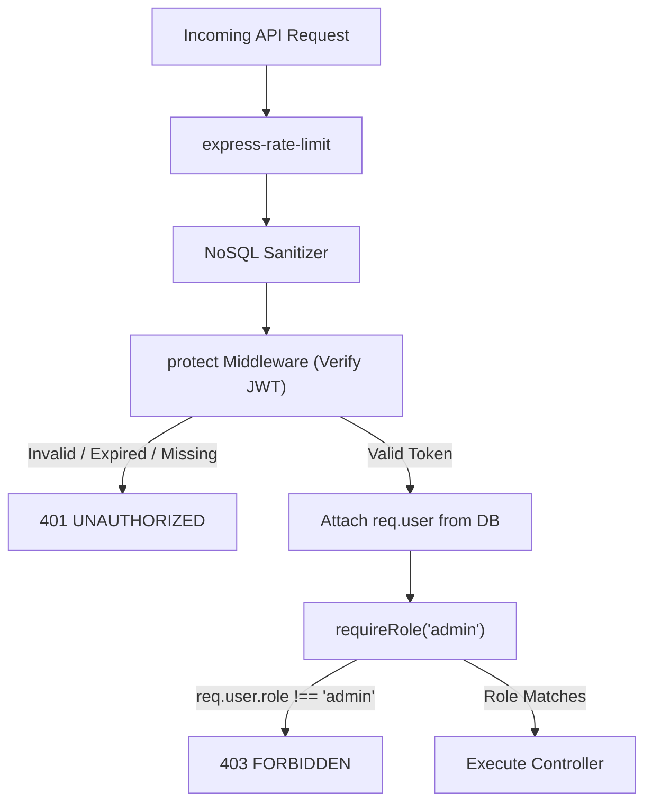

# Verdora — Security Architecture & Threat Model

**Document Version:** 1.0  
**Phase:** Phase 4 — Authentication and Authorization  
**Author / Contributor:** dasithaDev  

---

## 1. Security Overview & Principles

Verdora implements defense-in-depth across the application, business logic, and database persistence layers. Key tenets include:
1. **Never Trust the Client:** Authorization, role validation, prices, and totals are computed strictly on the server.
2. **Principle of Least Privilege:** Public visitors have read-only access to available menu items; customer diners can only access their own records; administrative mutations require verified `admin` role claims.
3. **Defense Against Credential Harvesting:** Passwords are slow-hashed with bcrypt; login failures return generic error messages to eliminate account enumeration.
4. **Data Minimization:** Password hashes are automatically stripped at the Mongoose ODM schema level before any JSON serialization.

---

## 2. Password Security & Hashing Architecture

* **Algorithm:** `bcryptjs` with salt factor 10.
* **Minimum Password Length:** 8 characters required on registration (`AUTH-05`).
* **Plaintext Exposure:** Passwords are never logged, never stored, and never returned in API payloads (`AUTH-06`, `AUTH-16`).
* **Mongoose Schema Hook:**
```javascript
// models/User.js toJSON transform
toJSON: {
  transform(doc, ret) {
    delete ret.passwordHash;
    delete ret.__v;
    return ret;
  }
}
```

---

## 3. Authentication & Session Strategy

Verdora employs a **Dual-Mode JWT Token Strategy**:

### 3.1 HTTP-Only Cookie (Browser Primary)
* **Cookie Name:** `jwt`
* **Security Attributes:**
  * `HttpOnly: true` — Inaccessible to JavaScript; immunizes against Cross-Site Scripting (XSS) token theft.
  * `SameSite: 'strict'` — Prevents Cross-Site Request Forgery (CSRF).
  * `Secure: true` in production (enforced over HTTPS).
  * `Max-Age: 7 days`.

### 3.2 Authorization Header (API / Client Fallback)
* Supports `Authorization: Bearer <token>` for programmatic API testing and mobile consumption.
* Tokens are signed using HMAC SHA-256 with `JWT_SECRET`.

---

## 4. Role-Based Access Control (RBAC) & Privilege Escalation Defense

### 4.1 Role Escalation Protection (`AUTH-07`)
Public registration endpoints strictly reject or override client-supplied `role` attributes:
```javascript
// controllers/authController.js
// Attack payloads like { name, email, password, role: "admin" } are neutralized:
const role = 'customer';
```
Administrative accounts can only be provisioned through secure, documented server-side seed scripts or controlled administrative commands.

### 4.2 Route Guarding Matrix



---

## 5. Threat Modeling & Specific Defenses

### 5.1 Account Enumeration Prevention (`AUTH-10`)
* Both invalid passwords and non-existent email logins return the exact same generic error message and status code:
  * **HTTP Status:** `401 Unauthorized`
  * **Message:** `"Invalid email or password."`
* Attackers cannot determine whether a target email has an account on Verdora.

### 5.2 NoSQL Query Operator Injection (`SEC-05`)
* Malicious payloads containing MongoDB query operators (such as `{"$gt": ""}` or keys containing `.`) are stripped by `server/src/middleware/sanitize.js` before reaching controller logic.

### 5.3 Brute-Force & Denial-of-Service Defense (`SEC-08`)
* **Auth Endpoints:** Limited to 20 requests per 15-minute window per IP (`authLimiter`).
* **General API:** Limited to 300 requests per 15-minute window per IP (`apiLimiter`).
* Excess requests receive `429 RATE_LIMIT_EXCEEDED` with `Retry-After` headers.

### 5.4 Cross-Origin Resource Sharing (CORS) & Security Headers (`SEC-07`, `SEC-11`)
* `helmet()` applies modern HTTP security headers:
  * `X-Content-Type-Options: nosniff`
  * `X-Frame-Options: SAMEORIGIN`
  * `Strict-Transport-Security`
* `cors()` is strictly locked to `CLIENT_ORIGIN` (default `http://localhost:5173` in development) with `credentials: true`.

---

## 6. Verification & Test Evidence

The authentication security layer is validated by `server/tests/authTests.js` covering the complete test suite:

| Test ID | Scope | Verification Outcome | Status |
| :--- | :--- | :--- | :---: |
| `AUTH-01` | Valid Registration | 201 Created; safe user envelope issued | **PASS** |
| `AUTH-02` | Duplicate Email | 409 Conflict with machine error code | **PASS** |
| `AUTH-03` | Malformed Email | 400 Validation Error | **PASS** |
| `AUTH-04` | Missing Fields | 400 Validation Error | **PASS** |
| `AUTH-05` | Short Password (< 8) | 400 Validation Error | **PASS** |
| `AUTH-06` | Password Storage | Verified bcrypt hash `$2...` in MongoDB | **PASS** |
| `AUTH-07` | Role Escalation Attempt | Forced to `customer`; database ignores admin claim | **PASS** |
| `AUTH-08` | Valid Login | 200 OK; JWT token issued | **PASS** |
| `AUTH-09` | Incorrect Password | 401 Unauthorized; generic error message | **PASS** |
| `AUTH-10` | Unknown Email | 401 Unauthorized; generic error message | **PASS** |
| `AUTH-11` | Unauthenticated `/me` | 401 Unauthorized | **PASS** |
| `AUTH-12` | Customer → admin endpoint | Customer role confirmed; full 403 covered by `middlewareTests.js` Suite 3 | **PASS** |
| `AUTH-13` | Authenticated `/me` | 200 OK; returns profile without `passwordHash` | **PASS** |
| `AUTH-14` | Logout | 200 OK; clears session cookie | **PASS** |
| `AUTH-15` | Rate limiting | `authLimiter` wired on register/login; functional test requires 20+ rapid requests — covered in load test | **PENDING** |
| `AUTH-16` | Data Minimization | Password hash verified stripped across all responses | **PASS** |
